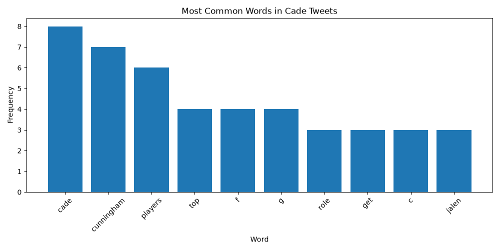
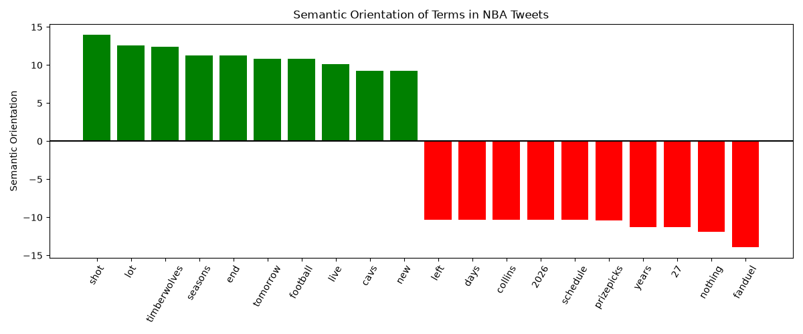

# NBA-Tweet-Sentiment
Python sentiment analysis using the X API, Tweepy, and Bing Liu's opinion lexicon to find which words are linked to positive or negative sentiment in NBA tweets, using PMI and Semantic Orientation.

## Method
- Tested Tweety API functions by analyzing word frequencies within Cade tweets.
- Collected recent English tweets about the NBA with the X API (Tweepy).
- Tokenized and cleaned text (removed links, mentions, stopwords).
- Computed term frequencies and word co-occurrence with sentiment words from
  Bing Liu's opinion lexicon, plus basketball slang I added.
- Calculated Pointwise Mutual Information (PMI) and Semantic Orientation for each term,
  following Turney's unsupervised approach.

## Results

## Setup
1. pip install -r requirements.txt
2. Download NLTK data: `python -c "import nltk; nltk.download('opinion_lexicon'); nltk.download('stopwords')"`
3. Copy `.env.example` to `.env` and add your own X API bearer token.
4. Run `python sentiment_analysis.py` and/or `python twitter_mining.py`

## Limitations
- Small sample (100 tweets due to budget constraints), so scores for rare words are noisy. Feel free to change the sample size.
- Lexicon methods can't detect sarcasm or negation.
- Tweets are usually a biased portion of fans since only those with strong opinions will tweet.
